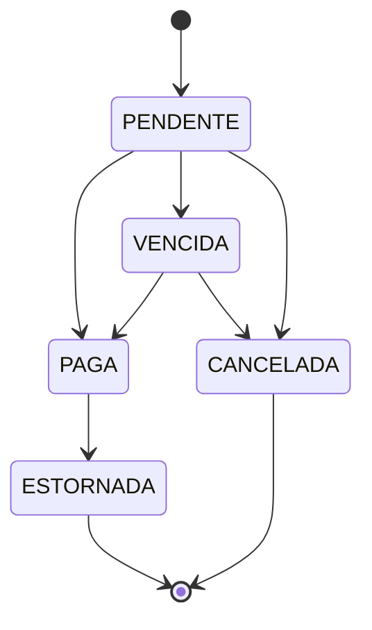

# Academia Gestão

[](https://github.com/ryan-victor-dev/academia-gestao/actions/workflows/ci.yml)


Sistema de gestão para academia: alunos, planos, matrículas, cobrança de
mensalidades, fichas de treino e controle de acesso por perfil.

Nasceu de um projeto real para uma academia e é desenvolvido em etapas, com
foco em código de produção: regras de negócio testadas, schema versionado,
build reproduzível e integração contínua.

## Stack

| Camada | Tecnologia |
|---|---|
| Linguagem / framework | Java 25, Spring Boot 4.1 (Web MVC, Data JPA, Security, Validation, Actuator) |
| Autenticação | JWT (HS256) com Spring Security OAuth2 Resource Server (Nimbus), senhas em BCrypt |
| Banco de dados | PostgreSQL 17, migrations com Flyway |
| Testes | JUnit 5, AssertJ, Testcontainers |
| Build / execução | Maven Wrapper, Docker (multi-stage), Docker Compose |
| Entrada / HTTPS | Caddy (certificado automático do Let's Encrypt) |
| CI | GitHub Actions (testes, build da imagem e envio das dependências ao GitHub) + Dependabot |

## Arquitetura

Monolito modular: um único deploy, com o código organizado **por domínio**, não
por camada.

```
br.com.academiagestao
├── alunos         cadastro de alunos
├── planos         planos e valores
├── matriculas     vínculo aluno ↔ plano
├── cobranca       mensalidades e pagamentos
├── treinos        fichas de treino
├── auth           autenticação e perfis
├── auditoria      registro de quem fez o quê
└── compartilhado  o que é comum a todos os módulos
```

A regra mais sensível — o ciclo de vida da mensalidade — é uma máquina de
estados em Java puro, sem dependência de framework ou banco:



Qualquer transição fora do diagrama lança `TransicaoInvalidaException`.

As decisões de arquitetura e seus motivos estão registradas em
[`docs/adr/`](docs/adr):

| ADR | Decisão |
|---|---|
| [0001](docs/adr/0001-registrar-decisoes-com-adrs.md) | Registrar decisões com ADRs |
| [0002](docs/adr/0002-monolito-modular-por-dominio.md) | Monolito modular com pacotes por domínio |
| [0003](docs/adr/0003-postgresql-e-flyway.md) | PostgreSQL com schema versionado pelo Flyway |
| [0004](docs/adr/0004-dominio-em-java-puro.md) | Regras de negócio em Java puro, separadas da persistência |
| [0005](docs/adr/0005-testes-com-testcontainers.md) | Testes de integração com Testcontainers |
| [0006](docs/adr/0006-empacotamento-em-docker.md) | Empacotamento em Docker e porta 8090 |
| [0007](docs/adr/0007-autenticacao-com-jwt.md) | Autenticação stateless com JWT (HS256) e perfis |
| [0008](docs/adr/0008-cadastro-de-alunos.md) | Cadastro de alunos: CPF, inativação e acesso por perfil |
| [0009](docs/adr/0009-login-do-aluno-e-edicao-simultanea.md) | Login do aluno, senha temporária, edição simultânea e visão do instrutor |
| [0010](docs/adr/0010-revogacao-de-tokens-e-redefinicao-de-senha.md) | Revogação imediata de tokens e redefinição de senha |
| [0011](docs/adr/0011-gestao-da-equipe-e-recuperacao-de-admin.md) | Gestão da equipe e recuperação de acesso de ADMIN |
| [0012](docs/adr/0012-endurecimento-de-seguranca.md) | Endurecimento de segurança (revisão de 2026-10-16) |

## Como rodar

Pré-requisito: Docker com o plugin Compose. Java e Maven **não** são necessários
para subir o sistema.

```bash
git clone https://github.com/ryan-victor-dev/academia-gestao.git
cd academia-gestao
cp .env.example .env   # e preencha (veja abaixo)
docker compose up --build
```

A entrada é o **Caddy**, com HTTPS: `https://localhost` (ou
`https://localhost:<HTTPS_PORTA>`). O HTTP só redireciona para o HTTPS. Sem
domínio, o certificado é de desenvolvimento e o navegador avisa que não confia
nele. Com `DOMINIO` apontando para o servidor e as portas 80 e 443 abertas, o
Caddy obtém e renova sozinho um certificado do Let's Encrypt.

A aplicação (porta 8090) e o banco (5432) só aceitam conexões da própria
máquina, nunca da rede. As migrations do Flyway são aplicadas automaticamente
na inicialização.

### Configurando o `.env`

O `.env` guarda os segredos locais e **não vai para o Git** (o modelo
versionado é o `.env.example`). O Docker Compose lê o arquivo sozinho.

| Variável | Para que serve |
|---|---|
| `POSTGRES_PASSWORD` | Senha do dono do banco, usado só pelas migrations. **Obrigatória** |
| `DB_APP_SENHA` | Senha do usuário da aplicação no banco (`academia_app`), que só lê e grava dados. Mínimo de 16 caracteres. **Obrigatória** |
| `ADMIN_NOME`, `ADMIN_EMAIL` | Dados do primeiro ADMIN |
| `ADMIN_SENHA` | Senha de primeiro acesso do ADMIN, mínimo de 12 caracteres. O sistema exige trocá-la no primeiro login |
| `JWT_SEGREDO` | Chave que assina os tokens: Base64, mínimo de 32 bytes. **Obrigatória** |
| `JWT_EXPIRACAO` | Validade do token (padrão `15m`) |
| `DOMINIO` | Domínio do sistema, para o HTTPS de verdade. Vazio = `localhost` |
| `HTTP_PORTA`, `HTTPS_PORTA` | Portas públicas do Caddy (padrão 80 e 443; o Let's Encrypt exige essas duas) |

Para gerar valores fortes:

```bash
openssl rand -base64 24   # POSTGRES_PASSWORD, DB_APP_SENHA e ADMIN_SENHA (um para cada)
openssl rand -base64 32   # JWT_SEGREDO
```

> **Já tinha subido o sistema antes de existir `POSTGRES_PASSWORD`?** O Postgres
> só usa essa variável ao criar o banco pela primeira vez. Depois de preencher o
> `.env`, troque a senha do banco existente uma vez:
>
> ```bash
> set -a; . ./.env; set +a
> echo "ALTER ROLE academia PASSWORD :'senha'" | \
>   docker exec -i academia-postgres psql -U academia -d academia -v senha="$POSTGRES_PASSWORD"
> docker compose up -d
> ```

Na primeira subida, se o banco não tiver nenhum ADMIN, ele é criado e o log
mostra `Primeiro ADMIN criado: <e-mail>`. Nas próximas, nada acontece:
mudar `ADMIN_SENHA` depois disso não altera a senha já gravada.

### Usando a API

```bash
# Na própria máquina (porta interna 8090). De fora, use https://<DOMINIO>.
# Login: devolve {"token": "...", "tipo": "Bearer", "expiraEm": "..."}
curl -X POST http://localhost:8090/api/auth/login \
     -H 'Content-Type: application/json' \
     -d '{"email": "admin@academia.local", "senha": "<ADMIN_SENHA>"}'

# Demais chamadas: token no cabeçalho Authorization
curl http://localhost:8090/api/me -H "Authorization: Bearer <token>"
```

| Rota | Acesso |
|---|---|
| `POST /api/auth/login` | Público |
| `POST /api/auth/trocar-senha` | Qualquer usuário logado (inclusive com senha temporária) |
| `GET /actuator/health` | Público |
| `GET /api/me` | Qualquer perfil logado |
| `GET /api/usuarios` | ADMIN |
| `POST /api/usuarios` (ADMIN, RECEPCAO ou INSTRUTOR, com senha temporária) | ADMIN |
| `PUT /api/usuarios/{id}` (nome e perfil; mudar o perfil derruba as sessões da pessoa) | ADMIN |
| `POST /api/usuarios/{id}/desativar`, `/reativar` | ADMIN |
| `POST /api/usuarios/{id}/nova-senha` (senha temporária; nunca para um ADMIN) | ADMIN |
| `GET /api/alunos?busca=&incluirInativos=&pagina=&tamanho=` | ADMIN, RECEPCAO, INSTRUTOR¹ |
| `GET /api/alunos/{id}` | ADMIN, RECEPCAO, INSTRUTOR¹ |
| `POST /api/alunos` | ADMIN, RECEPCAO |
| `PUT /api/alunos/{id}` (exige `If-Match`²) | ADMIN, RECEPCAO |
| `POST /api/alunos/{id}/inativar`, `/reativar` (levam o login junto) | ADMIN, RECEPCAO |
| `POST /api/alunos/{id}/login` (cria o login com senha temporária) | ADMIN, RECEPCAO |
| `POST /api/alunos/{id}/login/nova-senha` ("esqueci minha senha") | ADMIN, RECEPCAO |
| `GET /api/alunos/me` | ALUNO (o próprio cadastro) |

¹ O instrutor recebe só nome, data de nascimento, observações e se está ativo,
e busca apenas por nome.
² O `GET` devolve `ETag: "<versão>"`; o `PUT` precisa mandar
`If-Match: "<versão>"`, para nenhuma edição apagar outra feita no meio tempo.

Quem entra com senha temporária (login recém-criado ou senha redefinida) só
consegue trocar a senha (`POST /api/auth/trocar-senha`) e consultar `/api/me`.

Na gestão da equipe, ninguém desativa a si mesmo nem muda o próprio perfil, e o
sistema nunca deixa a academia sem pelo menos um ADMIN ativo.

Desativar, reativar, mudar o perfil, trocar ou redefinir a senha de um usuário
invalida na hora todos os tokens que ele já tinha: é preciso entrar de novo.

Erros saem em `application/problem+json` (RFC 9457): 400 para dados inválidos
(com a lista de campos em `erros`), 401 para token ausente, inválido ou
expirado, e para login recusado, 403 para perfil sem permissão (ou senha
temporária ainda não trocada), 404 para recurso inexistente, 409 para conflito
(ex.: CPF já cadastrado), 412 quando o aluno foi alterado por outra pessoa
desde o `GET`, 428 quando falta o `If-Match`, 413 para corpo acima de 64 KB e
429 para excesso de tentativas de login (20 por minuto por IP; 10 senhas erradas
em 15 minutos bloqueiam o e-mail), com o cabeçalho `Retry-After`.

### Recuperar o acesso de um ADMIN

Se um ADMIN esqueceu a senha, quem tem acesso ao servidor roda, na pasta do
projeto e com o sistema no ar:

```bash
docker compose run --rm app --recuperar-admin=admin@academia.local
```

O comando mostra uma senha temporária **só no terminal**, encerra e não deixa
container para trás. No primeiro acesso, o sistema exige uma senha nova. As
sessões abertas desse ADMIN caem na hora, e um login inativo é reativado.
E-mail inexistente ou de quem não é ADMIN termina com erro (código de saída 1)
sem mudar nada. Para os demais usuários, use as rotas de nova senha da API.

### Desenvolvimento local (fora do container)

Requer JDK 25. Sobe só o banco no Docker e roda a aplicação pelo Maven Wrapper:

```bash
docker compose up -d postgres
set -a; . ./.env; set +a   # carrega JWT_SEGREDO e ADMIN_* no shell
./mvnw spring-boot:run
```

### Testes

Requer Docker ligado (o Testcontainers sobe um PostgreSQL descartável):

```bash
./mvnw verify
```

> Nenhuma senha real fica no repositório: tudo vem do `.env`. O banco só aceita
> conexões desta máquina (`127.0.0.1`), nunca da rede. Os testes usam valores
> próprios, em `src/test/resources/config/application.yaml`, e não precisam do `.env`.

## Roadmap

- [x] **1. Fundação** — projeto, Postgres no Docker, Flyway, máquina de estados da mensalidade, Dockerfile, CI
- [x] **2. Autenticação** — login com JWT, senhas em BCrypt, perfis (ADMIN, RECEPCAO, INSTRUTOR, ALUNO) e autorização por perfil
- [x] **3. Alunos** — cadastro com validação de CPF, busca paginada, inativação e acesso por perfil
- [ ] **4–8.** Planos, matrículas, cobrança, treinos e auditoria

## Autor

Ryan Victor — [GitHub](https://github.com/ryan-victor-dev)
