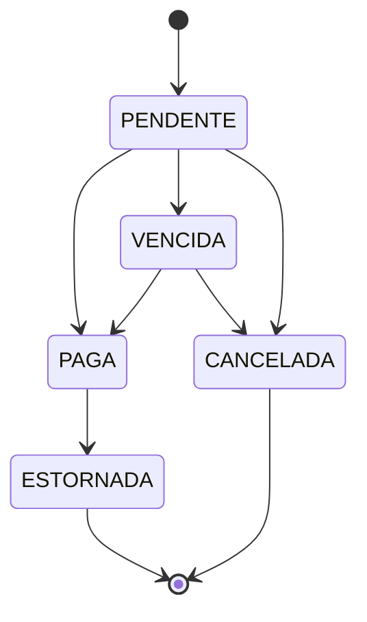

# Academia Gestão

[](https://github.com/ryan-victor-dev/academia-gestao/actions/workflows/ci.yml)


Sistema de gestão para academia: alunos, planos, matrículas, cobrança de
mensalidades, fichas de treino e controle de acesso por perfil.

Nasceu de um projeto real para uma academia e é desenvolvido em etapas, com
foco em código de produção: regras de negócio testadas, schema versionado,
build reproduzível e integração contínua.

## Stack

| Camada | Tecnologia |
|---|---|
| Linguagem / framework | Java 25, Spring Boot 4.1 (Web MVC, Data JPA, Security, Validation, Actuator) |
| Banco de dados | PostgreSQL 17, migrations com Flyway |
| Testes | JUnit 5, AssertJ, Testcontainers |
| Build / execução | Maven Wrapper, Docker (multi-stage), Docker Compose |
| CI | GitHub Actions (testes + build da imagem a cada push e PR) |

## Arquitetura

Monolito modular: um único deploy, com o código organizado **por domínio**, não
por camada.

```
br.com.academiagestao
├── alunos         cadastro de alunos
├── planos         planos e valores
├── matriculas     vínculo aluno ↔ plano
├── cobranca       mensalidades e pagamentos
├── treinos        fichas de treino
├── auth           autenticação e perfis
├── auditoria      registro de quem fez o quê
└── compartilhado  o que é comum a todos os módulos
```

A regra mais sensível — o ciclo de vida da mensalidade — é uma máquina de
estados em Java puro, sem dependência de framework ou banco:



Qualquer transição fora do diagrama lança `TransicaoInvalidaException`.

As decisões de arquitetura e seus motivos estão registradas em
[`docs/adr/`](docs/adr):

| ADR | Decisão |
|---|---|
| [0001](docs/adr/0001-registrar-decisoes-com-adrs.md) | Registrar decisões com ADRs |
| [0002](docs/adr/0002-monolito-modular-por-dominio.md) | Monolito modular com pacotes por domínio |
| [0003](docs/adr/0003-postgresql-e-flyway.md) | PostgreSQL com schema versionado pelo Flyway |
| [0004](docs/adr/0004-dominio-em-java-puro.md) | Regras de negócio em Java puro, separadas da persistência |
| [0005](docs/adr/0005-testes-com-testcontainers.md) | Testes de integração com Testcontainers |
| [0006](docs/adr/0006-empacotamento-em-docker.md) | Empacotamento em Docker e porta 8090 |

## Como rodar

Pré-requisito: Docker com o plugin Compose. Java e Maven **não** são necessários
para subir o sistema.

```bash
git clone https://github.com/ryan-victor-dev/academia-gestao.git
cd academia-gestao
docker compose up --build
```

A aplicação sobe em `http://localhost:8090` assim que o Postgres passa no
healthcheck. As migrations do Flyway são aplicadas automaticamente na
inicialização.

### Desenvolvimento local (fora do container)

Requer JDK 25. Sobe só o banco no Docker e roda a aplicação pelo Maven Wrapper:

```bash
docker compose up -d postgres
./mvnw spring-boot:run
```

### Testes

Requer Docker ligado (o Testcontainers sobe um PostgreSQL descartável):

```bash
./mvnw verify
```

> As credenciais em `docker-compose.yml` e `application.yaml` são apenas para
> desenvolvimento local.

## Roadmap

- [x] **1. Fundação** — projeto, Postgres no Docker, Flyway, máquina de estados da mensalidade, Dockerfile, CI
- [ ] **2. Autenticação** — login com JWT e perfis (ADMIN, RECEPCAO, INSTRUTOR, ALUNO)
- [ ] **3–8.** Alunos, planos, matrículas, cobrança, treinos e auditoria

## Autor

Ryan Victor — [GitHub](https://github.com/ryan-victor-dev)
