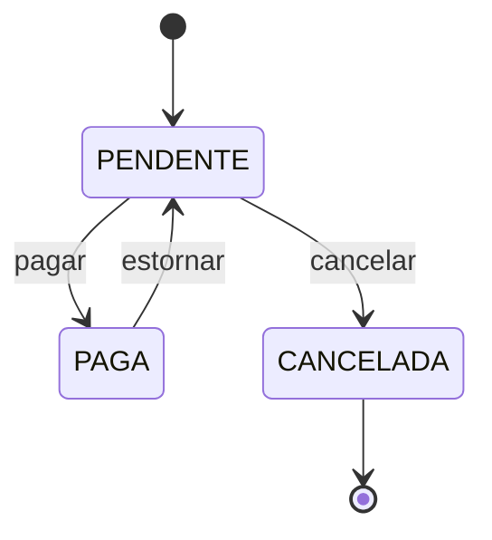

# Academia Gestão

[](https://github.com/ryan-victor-dev/academia-gestao/actions/workflows/ci.yml)


Sistema de gestão para academia: alunos, planos, matrículas, cobrança de
mensalidades, fichas de treino e controle de acesso por perfil.

Nasceu de um projeto real para uma academia e é desenvolvido em etapas, com
foco em código de produção: regras de negócio testadas, schema versionado,
build reproduzível e integração contínua.

## Stack

| Camada | Tecnologia |
|---|---|
| Linguagem / framework | Java 25, Spring Boot 4.1 (Web MVC, Data JPA, Security, Validation, Actuator) |
| Autenticação | JWT (HS256) com Spring Security OAuth2 Resource Server (Nimbus), senhas em BCrypt |
| Banco de dados | PostgreSQL 17, migrations com Flyway |
| Testes | JUnit 5, AssertJ, Testcontainers, ArchUnit (fronteiras entre módulos), PIT (mutação) |
| Build / execução | Maven Wrapper, Docker (multi-stage), Docker Compose |
| Entrada / HTTPS | Caddy (certificado automático do Let's Encrypt) |
| CI | GitHub Actions (testes, build da imagem e envio das dependências ao GitHub) + Dependabot |

## Arquitetura

Monolito modular: um único deploy, com o código organizado **por domínio**, não
por camada.

```
br.com.academiagestao
├── alunos         cadastro de alunos
├── planos         planos e valores
├── matriculas     vínculo aluno ↔ plano
├── cobranca       cobranças, atraso, pagamentos (regras em Java puro em cobranca.dominio)
├── treinos        fichas de treino
├── auth           autenticação e perfis
├── auditoria      registro de quem fez o quê
└── compartilhado  o que é comum a todos os módulos
```

A regra mais sensível — o ciclo de vida da cobrança — é uma máquina de estados em
Java puro, sem dependência de framework ou banco (ADR 0024). "Atrasada" não é um
estado guardado: é a pendente com o vencimento no passado.



Qualquer transição fora do diagrama lança `TransicaoInvalidaException`. O estorno não
apaga o pagamento: os dois ficam no registro de lançamentos, que só cresce (ADR 0025).

As decisões de arquitetura e seus motivos estão registradas em
[`docs/adr/`](docs/adr):

| ADR | Decisão |
|---|---|
| [0001](docs/adr/0001-registrar-decisoes-com-adrs.md) | Registrar decisões com ADRs |
| [0002](docs/adr/0002-monolito-modular-por-dominio.md) | Monolito modular com pacotes por domínio |
| [0003](docs/adr/0003-postgresql-e-flyway.md) | PostgreSQL com schema versionado pelo Flyway |
| [0004](docs/adr/0004-dominio-em-java-puro.md) | Regras de negócio em Java puro, separadas da persistência |
| [0005](docs/adr/0005-testes-com-testcontainers.md) | Testes de integração com Testcontainers |
| [0006](docs/adr/0006-empacotamento-em-docker.md) | Empacotamento em Docker e porta 8090 |
| [0007](docs/adr/0007-autenticacao-com-jwt.md) | Autenticação stateless com JWT (HS256) e perfis |
| [0008](docs/adr/0008-cadastro-de-alunos.md) | Cadastro de alunos: CPF, inativação e acesso por perfil |
| [0009](docs/adr/0009-login-do-aluno-e-edicao-simultanea.md) | Login do aluno, senha temporária, edição simultânea e visão do instrutor |
| [0010](docs/adr/0010-revogacao-de-tokens-e-redefinicao-de-senha.md) | Revogação imediata de tokens e redefinição de senha |
| [0011](docs/adr/0011-gestao-da-equipe-e-recuperacao-de-admin.md) | Gestão da equipe e recuperação de acesso de ADMIN |
| [0012](docs/adr/0012-endurecimento-de-seguranca.md) | Endurecimento de segurança (revisão de 2026-10-16) |
| [0013](docs/adr/0013-planos.md) | Planos: preço, nome único e quem vê o quê |
| [0014](docs/adr/0014-segunda-revisao-de-seguranca.md) | Segunda revisão de segurança (2026-10-17) |
| [0015](docs/adr/0015-testes-de-arquitetura-e-mutacao.md) | Testes de arquitetura (ArchUnit) e de mutação (PIT) |
| [0016](docs/adr/0016-matriculas.md) | Matrículas: preço congelado, períodos sem sobreposição e quem vê o quê |
| [0017](docs/adr/0017-matriculas-decisoes-da-implementacao.md) | Matrículas: decisões tomadas durante a implementação |
| [0018](docs/adr/0018-fidelidade-trancamento-troca-e-vencimento.md) | Fidelidade, forma de pagamento, trancamento, troca de plano e vencimento |
| [0019](docs/adr/0019-fidelidade-trancamento-e-troca-decisoes-da-implementacao.md) | Fidelidade, trancamento e troca: decisões tomadas durante a implementação |
| [0020](docs/adr/0020-terceira-revisao-login-troca-e-backup.md) | Terceira revisão (2026-10-17): login sob carga, troca de plano e backup |
| [0021](docs/adr/0021-pendencias-medias-da-terceira-revisao.md) | Pendências médias da terceira revisão: limites, tempos, índices, datas e auditoria |
| [0022](docs/adr/0022-bloqueio-por-conta-e-ip-e-retencao-da-auditoria.md) | Bloqueio de login por conta e IP, e retenção da trilha de auditoria |
| [0023](docs/adr/0023-relogio-unico-e-limpeza-central-dos-testes.md) | Relógio único (datas testáveis, fuso da academia) e limpeza central dos testes |
| [0024](docs/adr/0024-cobranca.md) | Cobrança: mensalidades, atraso, pagamento e inadimplência |
| [0025](docs/adr/0025-pendencias-medias-da-cobranca.md) | Pendências médias da cobrança: teto do plano, subida e registro de pagamentos |
| [0026](docs/adr/0026-estorno-e-troca-na-cobranca.md) | Estorno e troca de plano na cobrança: prazo do estorno, crédito do não usado |
| [0027](docs/adr/0027-treinos.md) | Treinos: catálogo de exercícios, ficha atual com histórico e quem vê o quê |
| [0028](docs/adr/0028-pendencias-medias-dos-treinos.md) | Pendências médias dos treinos: OOM, histórico imutável no banco, caractere de controle, listas em páginas, teto da revisão |
| [0029](docs/adr/0029-login-do-aluno-inativo-so-de-leitura.md) | Login do aluno inativo, só de leitura: vê os próprios dados, não altera nada |

## Como rodar

Pré-requisito: Docker com o plugin Compose. Java e Maven **não** são necessários
para subir o sistema.

```bash
git clone https://github.com/ryan-victor-dev/academia-gestao.git
cd academia-gestao
cp .env.example .env   # e preencha (veja abaixo)
docker compose up --build
```

A entrada é o **Caddy**, com HTTPS: `https://localhost` (ou
`https://localhost:<HTTPS_PORTA>`). O HTTP só redireciona para o HTTPS. Sem
domínio, o certificado é de desenvolvimento e o navegador avisa que não confia
nele. Com `DOMINIO` apontando para o servidor e as portas 80 e 443 abertas, o
Caddy obtém e renova sozinho um certificado do Let's Encrypt.

A aplicação (porta 8090) e o banco (5432) só aceitam conexões da própria
máquina, nunca da rede. As migrations do Flyway são aplicadas automaticamente
na inicialização.

### Configurando o `.env`

O `.env` guarda os segredos locais e **não vai para o Git** (o modelo
versionado é o `.env.example`). O Docker Compose lê o arquivo sozinho.

| Variável | Para que serve |
|---|---|
| `POSTGRES_PASSWORD` | Senha do dono do banco, usado só pelas migrations. **Obrigatória** |
| `DB_APP_SENHA` | Senha do usuário da aplicação no banco (`academia_app`), que só lê e grava dados. Mínimo de 16 caracteres. **Obrigatória** |
| `ADMIN_NOME`, `ADMIN_EMAIL` | Dados do primeiro ADMIN |
| `ADMIN_SENHA` | Senha de primeiro acesso do ADMIN, mínimo de 12 caracteres. O sistema exige trocá-la no primeiro login |
| `JWT_SEGREDO` | Chave que assina os tokens: Base64, mínimo de 32 bytes. **Obrigatória** |
| `JWT_EXPIRACAO` | Validade do token (padrão `15m`) |
| `DOMINIO` | Domínio do sistema, para o HTTPS de verdade. Vazio = `localhost` |
| `HTTP_PORTA`, `HTTPS_PORTA` | Portas públicas do Caddy (padrão 80 e 443; o Let's Encrypt exige essas duas) |
| `APP_MEMORIA`, `APP_CPUS`, `POSTGRES_MEMORIA`, `POSTGRES_CPUS` | Teto de memória e de núcleos da aplicação e do banco (padrão 1 GiB e 2 núcleos cada); o Caddy e o backup têm tetos fixos |

Para gerar valores fortes:

```bash
openssl rand -base64 24   # POSTGRES_PASSWORD, DB_APP_SENHA e ADMIN_SENHA (um para cada)
openssl rand -base64 32   # JWT_SEGREDO
```

> **Já tinha subido o sistema antes de existir `POSTGRES_PASSWORD`?** O Postgres
> só usa essa variável ao criar o banco pela primeira vez. Depois de preencher o
> `.env`, troque a senha do banco existente uma vez:
>
> ```bash
> set -a; . ./.env; set +a
> echo "ALTER ROLE academia PASSWORD :'senha'" | \
>   docker exec -i academia-postgres psql -U academia -d academia -v senha="$POSTGRES_PASSWORD"
> docker compose up -d
> ```

Na primeira subida, se o banco não tiver nenhum ADMIN, ele é criado e o log
mostra `Primeiro ADMIN criado: <e-mail>`. Nas próximas, nada acontece:
mudar `ADMIN_SENHA` depois disso não altera a senha já gravada.

### Usando a API

```bash
# Na própria máquina (porta interna 8090). De fora, use https://<DOMINIO>.
# Login: devolve {"token": "...", "tipo": "Bearer", "expiraEm": "..."}
curl -X POST http://localhost:8090/api/auth/login \
     -H 'Content-Type: application/json' \
     -d '{"email": "admin@academia.local", "senha": "<ADMIN_SENHA>"}'

# Demais chamadas: token no cabeçalho Authorization
curl http://localhost:8090/api/me -H "Authorization: Bearer <token>"
```

| Rota | Acesso |
|---|---|
| `POST /api/auth/login` | Público |
| `POST /api/auth/trocar-senha` | Qualquer usuário logado (inclusive com senha temporária) |
| `GET /actuator/health` | Público |
| `GET /api/me` | Qualquer perfil logado |
| `GET /api/usuarios` | ADMIN |
| `POST /api/usuarios` (ADMIN, RECEPCAO ou INSTRUTOR, com senha temporária) | ADMIN |
| `PUT /api/usuarios/{id}` (nome e perfil; mudar o perfil derruba as sessões da pessoa) | ADMIN |
| `POST /api/usuarios/{id}/desativar`, `/reativar` | ADMIN |
| `POST /api/usuarios/{id}/nova-senha` (senha temporária; nunca para um ADMIN) | ADMIN |
| `GET /api/alunos?busca=&incluirInativos=&pagina=&tamanho=` | ADMIN, RECEPCAO, INSTRUTOR¹ |
| `GET /api/alunos/{id}` | ADMIN, RECEPCAO, INSTRUTOR¹ |
| `POST /api/alunos` | ADMIN, RECEPCAO |
| `PUT /api/alunos/{id}` (exige `If-Match`²) | ADMIN, RECEPCAO |
| `POST /api/alunos/{id}/inativar`, `/reativar` (inativar deixa o login só de leitura⁹, reativar o libera; inativar com matrícula vigente ou agendada dá 409) | ADMIN, RECEPCAO |
| `POST /api/alunos/{id}/login` (cria o login com senha temporária) | ADMIN, RECEPCAO |
| `POST /api/alunos/{id}/login/nova-senha` ("esqueci minha senha") | ADMIN, RECEPCAO |
| `GET /api/alunos/me` | ALUNO (o próprio cadastro) |
| `GET /api/planos?incluirInativos=`, `GET /api/planos/{id}` | Todos os perfis³ |
| `POST /api/planos`, `PUT /api/planos/{id}` (exige `If-Match`²; `fidelidade`, `percentualMulta` e `formaPagamento` opcionais⁵) | ADMIN |
| `POST /api/planos/{id}/inativar`, `/reativar` | ADMIN |
| `POST /api/matriculas` (`alunoId`, `planoId`, `inicio` opcional; copia nome, valor e duração do plano⁴) | ADMIN, RECEPCAO |
| `GET /api/matriculas/{id}`, `GET /api/matriculas?alunoId=` (histórico) | ADMIN, RECEPCAO |
| `POST /api/matriculas/{id}/cancelar` (`motivo` obrigatório; com fidelidade, grava a multa⁵) | ADMIN, RECEPCAO |
| `POST /api/matriculas/{id}/trancar` (`voltaPrevista` e `motivo`; `inicio` opcional) e `/registrar-volta` | ADMIN, RECEPCAO |
| `POST /api/matriculas/{id}/trocar-plano` (`planoId`; devolve a matrícula nova) | ADMIN, RECEPCAO |
| `GET /api/matriculas/vigente?alunoId=` (`podeTreinar`: matrícula vigente e nenhuma cobrança atrasada além do tolerado⁷) | ADMIN, RECEPCAO, INSTRUTOR |
| `GET /api/matriculas/me` | ALUNO (as próprias) |
| `GET /api/cobrancas?alunoId=`, `GET /api/cobrancas/{id}` (situação e o devido hoje⁷) | ADMIN, RECEPCAO |
| `GET /api/cobrancas/atrasadas?pagina=&tamanho=` (as em aberto já vencidas, da mais antiga) | ADMIN, RECEPCAO |
| `POST /api/cobrancas/{id}/pagar` (`valor` igual ao devido hoje e `meioDePagamento`: `DINHEIRO`, `PIX`, `CARTAO_DEBITO` ou `CARTAO_CREDITO`) | ADMIN, RECEPCAO |
| `POST /api/cobrancas/{id}/estornar` (volta a dever) e `/cancelar` (só em aberto), com `motivo` | ADMIN |
| `GET /api/cobrancas/{id}/lancamentos` (pagamentos e estornos, na ordem; nada se apaga⁷) | ADMIN, RECEPCAO |
| `GET /api/cobrancas/configuracao`, `PUT` (exige `If-Match`²; acréscimo, juros e dias para bloquear⁷) | Ler: ADMIN, RECEPCAO; alterar: ADMIN |
| `GET /api/cobrancas/me` | ALUNO (as próprias) |
| `GET /api/exercicios?grupoMuscular=&incluirInativos=`, `GET /api/exercicios/{id}` (catálogo⁸) | ADMIN, INSTRUTOR |
| `POST /api/exercicios`, `PUT /api/exercicios/{id}` (exige `If-Match`²), `POST /api/exercicios/{id}/inativar`, `/reativar` | ADMIN, INSTRUTOR |
| `POST /api/fichas` (`alunoId`, `divisoes`, `revisaoEm` opcional, até 1 ano à frente; encerra a atual⁸) | ADMIN, INSTRUTOR |
| `PUT /api/fichas/{id}` (corrige a atual; exige `If-Match`²) | ADMIN, INSTRUTOR |
| `GET /api/fichas/{id}`, `GET /api/fichas/atual?alunoId=`, `GET /api/fichas?alunoId=&pagina=&tamanho=` (histórico, a mais nova primeiro; 10 por página, até 20) | ADMIN, INSTRUTOR, RECEPCAO |
| `GET /api/fichas/revisoes-vencidas?pagina=&tamanho=` (atuais com a revisão até hoje, da mais antiga; 20 por página, até 100) | ADMIN, INSTRUTOR |
| `GET /api/fichas/me?pagina=&tamanho=` | ALUNO (as próprias, a atual primeiro; páginas como o histórico) |
| `GET /api/auditoria?entidade=&entidadeId=&pagina=&tamanho=` (quem alterou planos, alunos, usuários, cobranças e fichas, e o valor anterior⁶) | ADMIN |

¹ O instrutor recebe só nome, data de nascimento, observações e se está ativo,
e busca apenas por nome.
² O `GET` devolve `ETag: "<versão>"`; o `PUT` precisa mandar
`If-Match: "<versão>"`, para nenhuma edição apagar outra feita no meio tempo.
³ O aluno vê só os planos ativos, sem `ativo` e `criadoEm`. Reajustar o valor de
um plano vale para matrículas novas.
⁴ A matrícula começa hoje ou numa data futura e vai até início + N meses − 1 dia
(17/10 a 16/11 no plano mensal), mais os dias trancados. Os períodos de um aluno não
se sobrepõem, mas dá para agendar a renovação a partir do dia seguinte ao fim. A
situação (`AGENDADA`, `VIGENTE`, `TRANCADA`, `ENCERRADA`, `CANCELADA`, `TROCADA`) sai
das datas, no fuso de São Paulo. Trancamento: de 7 a 90 dias (90 somados), estende o
fim; a volta antecipada conta só os dias parados. Troca: a atual termina na véspera e
a nova começa hoje. O início pode ser agendado para até 1 ano à frente.
⁵ O dono define em cada plano se há fidelidade (com percentual de multa de 0,01% a
100%) e se o pagamento é mensal ou à vista; a matrícula copia essas regras. Sair antes
do fim de uma matrícula com fidelidade gera multa = percentual × meses inteiros que
faltam × valor mensal; a troca não gera multa só se a multa que o plano novo cobraria
(saindo logo depois da troca) for pelo menos a que a matrícula atual cobraria hoje.
⁶ `entidade` é `PLANO`, `ALUNO`, `USUARIO`, `COBRANCA`, `CONFIGURACAO`, `EXERCICIO` ou `FICHA`. Cada registro traz quem fez (`autor`, o id
do usuário; vazio quando foi o próprio sistema, como a recuperação de ADMIN pela linha
de comando), quando, a ação e só os campos que mudaram (`antes` e `depois`), nunca
senhas. A trilha é gravada na mesma transação da alteração, e o usuário da aplicação no
banco não consegue apagá-la nem reescrevê-la. Registros com mais de 5 anos são apagados
todo dia (ADR 0022).
⁷ Cobrança (ADR 0024): a matrícula gera as cobranças sozinha. No mensal, uma por mês, no
dia do início (sem esse dia no mês, no último dia dele); no à vista, uma com o total no
início. O trancamento empurra as seguintes pelos dias parados. O cancelamento cancela as
que vencem depois do dia (o mês em curso conta como usado) e a multa de fidelidade vira
uma cobrança avulsa. A recepção registra o pagamento no balcão, só pelo valor exato devido
no dia: outro valor dá 409 com o devido de hoje. Atrasada desde o dia seguinte ao
vencimento, ela soma um acréscimo único (percentual ou em reais, cortado em 2% do valor,
o teto do CDC) e juros simples por dia (padrão 2% e 1% ao mês, editáveis pelo ADMIN e
válidos para todas a partir da mudança). Depois de 10 dias de atraso (editável), o
"pode treinar?" diz não. Só o ADMIN estorna (a cobrança volta a dever) ou cancela, com
motivo; tudo vai para a trilha (`entidade` `COBRANCA` ou `CONFIGURACAO`). Cada pagamento e
cada estorno entram também no registro de lançamentos, onde o estorno é um lançamento novo
que aponta para o pagamento (ADR 0025). Depois de um estorno, acréscimo, juros e bloqueio
contam do dia do estorno; o estorno de uma paga adiantada de matrícula cancelada a cancela
(ADR 0026). Na troca de plano, a nova cobra a partir do próximo vencimento da antiga, e o
que foi cobrado e não usado (o à vista, a paga adiantada) vira crédito abatido das primeiras
parcelas dela; crédito maior que o plano novo inteiro recusa a troca (409). As matrículas
que já existiam antes da cobrança ganharam só as cobranças de hoje em diante. O valor
mensal de um plano vai até R$ 100.000.
⁸ Treinos (ADR 0027): os instrutores mantêm o catálogo de exercícios (nome único entre os
ativos, grupo muscular, observação de execução); exercício não se apaga, é inativado e sai
das fichas novas. A ficha tem de 1 a 7 divisões (Treino A, B…), cada uma com 1 a 20
exercícios em ordem: séries (1 a 20), repetições e carga em texto ("8 a 12", "peso do
corpo"), descanso (0 a 600 s) e observação. Ela copia o nome do exercício: renomear no
catálogo não muda as fichas. Cada aluno ativo tem no máximo uma ficha atual; montar outra
encerra a anterior, que fica no histórico e nunca mais muda (o banco recusa). A correção
troca as divisões da atual e vai para a trilha; um exercício que já estava na ficha pode
ficar mesmo inativado depois, para corrigir a carga sem trocá-lo. A data de revisão é
opcional e precisa ser depois do dia da montagem; vencida, a ficha continua valendo, e
a lista de revisões vencidas deixa de fora os alunos inativos. O aluno não vê quem da
equipe montou a ficha.
⁹ Aluno inativo (ADR 0029): o login dele continua, só de leitura. Ele entra, consulta os
próprios dados (cadastro, matrículas, cobranças, fichas) e os planos, e troca a própria
senha; qualquer outra coisa que não seja consulta dá 403. Os tokens de antes da
inativação caem na hora. Não ganha senha nova pela recepção nem login novo: para isso,
reative o aluno. `/api/me` mostra `somenteLeitura`.

Quem entra com senha temporária (login recém-criado ou senha redefinida) só
consegue trocar a senha (`POST /api/auth/trocar-senha`) e consultar `/api/me`.

Na gestão da equipe, ninguém desativa a si mesmo nem muda o próprio perfil, e o
sistema nunca deixa a academia sem pelo menos um ADMIN ativo.

Desativar, reativar, mudar o perfil, trocar ou redefinir a senha de um usuário
invalida na hora todos os tokens que ele já tinha: é preciso entrar de novo.

Erros saem em `application/problem+json` (RFC 9457): 400 para dados inválidos
(com a lista de campos em `erros`), 401 para token ausente, inválido ou
expirado, e para login recusado, 403 para perfil sem permissão (ou senha
temporária ainda não trocada), 404 para recurso inexistente, 409 para conflito
(ex.: CPF já cadastrado, período de matrícula ocupado, valor diferente do devido, cobrança já paga), 412 quando o aluno foi alterado por outra pessoa
desde o `GET`, 428 quando falta o `If-Match`, 413 para corpo acima de 64 KB,
429 para excesso de tentativas de login (20 por minuto por IP; 10 senhas erradas
em 15 minutos bloqueiam o e-mail para aquele IP, e 100 somando todos os IPs o bloqueiam
para todos) ou de requisições (300 por minuto por usuário
logado) e 503 quando o banco está sobrecarregado (nenhuma conexão livre em 3 s ou
consulta acima de 5 s); 429 e 503 trazem o cabeçalho `Retry-After`.

### Backup e restauração

O serviço `backup` do Compose faz um `pg_dump` do banco todo dia, a partir das 3h
(`BACKUP_HORA`), na pasta `BACKUP_PASTA` (padrão `./backups`, fora do Git). Guarda 7
diários (`backups/diario`) e 4 semanais (`backups/semanal`). Se o servidor estiver
desligado no horário, o backup é feito assim que ele voltar. Cada arquivo é conferido
antes de valer, e o log mostra `Backup ok` ou `BACKUP FALHOU`
(`docker logs academia-backup`).

> **Copie a pasta de backups para fora do servidor** (HD externo, outro computador,
> nuvem). Contra disco queimado ou servidor perdido, só uma cópia em outro lugar salva.

```bash
docker compose run --rm backup agora                                      # backup na hora
scripts/restaurar-backup.sh backups/diario/academia-AAAA-MM-DD.dump --sim  # restaurar
```

Restaurar **apaga os dados atuais**: o script salva antes o estado atual em
`backups/antes-de-restaurar-*.dump` (para desfazer), para a aplicação, restaura numa
transação só (se falhar, nada muda) e sobe a aplicação de novo. O `scripts/e2e.sh`
testa o backup e a restauração numa instalação do zero.

### Recuperar o acesso de um ADMIN

Se um ADMIN esqueceu a senha, quem tem acesso ao servidor roda, na pasta do
projeto e com o sistema no ar:

```bash
docker compose run --rm app --recuperar-admin=admin@academia.local
```

O comando mostra uma senha temporária **só no terminal**, encerra e não deixa
container para trás. No primeiro acesso, o sistema exige uma senha nova. As
sessões abertas desse ADMIN caem na hora, e um login inativo é reativado.
E-mail inexistente ou de quem não é ADMIN termina com erro (código de saída 1)
sem mudar nada. Para os demais usuários, use as rotas de nova senha da API.

### Desenvolvimento local (fora do container)

Requer JDK 25. Sobe só o banco no Docker e roda a aplicação pelo Maven Wrapper:

```bash
docker compose up -d postgres
set -a; . ./.env; set +a   # carrega JWT_SEGREDO e ADMIN_* no shell
./mvnw spring-boot:run
```

### Testes

Requer Docker ligado (o Testcontainers sobe um PostgreSQL descartável):

```bash
./mvnw verify
```

O `verify` também confere as fronteiras entre os módulos (`ArquiteturaTest`), inclusive
que ninguém lê a hora do sistema fora do relógio único (ADR 0023). Nos testes, o
`RelogioDeTeste` para, adianta ou fixa esse relógio, e `LimpezaDoBanco.apagarTudo()` apaga
todas as tabelas na ordem das chaves estrangeiras.
Para checar se os testes de domínio realmente pegam erros (teste de mutação):

```bash
./mvnw -P mutacao test-compile org.pitest:pitest-maven:mutationCoverage
# relatório em target/pit-reports/index.html
```

Teste de ponta a ponta numa instalação do zero, isolada do seu ambiente (outras portas
e containers; tudo é apagado no final):

```bash
scripts/e2e.sh
```

`scripts/usuario-validacao.sh PERFIL` cria um usuário de teste direto no banco e devolve
um token dele. É só para desenvolvimento: ele se recusa a rodar se o `.env` tiver um
`DOMINIO` configurado.

> Nenhuma senha real fica no repositório: tudo vem do `.env`. O banco só aceita
> conexões desta máquina (`127.0.0.1`), nunca da rede. Os testes usam valores
> próprios, em `src/test/resources/config/application.yaml`, e não precisam do `.env`.

## Roadmap

- [x] **1. Fundação** — projeto, Postgres no Docker, Flyway, máquina de estados da mensalidade, Dockerfile, CI
- [x] **2. Autenticação** — login com JWT, senhas em BCrypt, perfis (ADMIN, RECEPCAO, INSTRUTOR, ALUNO) e autorização por perfil
- [x] **3. Alunos** — cadastro com validação de CPF, busca paginada, inativação e acesso por perfil
- [x] **4. Planos** — preço com duas casas, nome único entre os ativos, só o ADMIN altera, aluno vê os ativos
- [x] **5. Matrículas** — preço e regras do plano congelados na matrícula, períodos sem sobreposição garantidos pelo banco, fidelidade com multa, trancamento, troca de plano, visões do instrutor e do aluno
- [x] **6. Cobrança** — mensalidades geradas pela matrícula (trancamento empurra, cancelamento cancela as futuras, multa vira cobrança), pagamento no balcão pelo valor exato, acréscimo com teto de 2% e juros editáveis, estorno e cancelamento pelo ADMIN, bloqueio do inadimplente no "pode treinar?"
- [x] **7. Treinos** — catálogo de exercícios, ficha com divisões e uma atual por aluno (garantido pelo banco), correção com trilha, histórico imutável, revisões vencidas para os instrutores, visão do aluno
- [ ] **8.** Fechamento de caixa e auditoria completa (a trilha de planos, alunos, usuários, cobranças e fichas já existe: ADRs 0021, 0024 e 0027)

## Autor

Ryan Victor — [GitHub](https://github.com/ryan-victor-dev)
